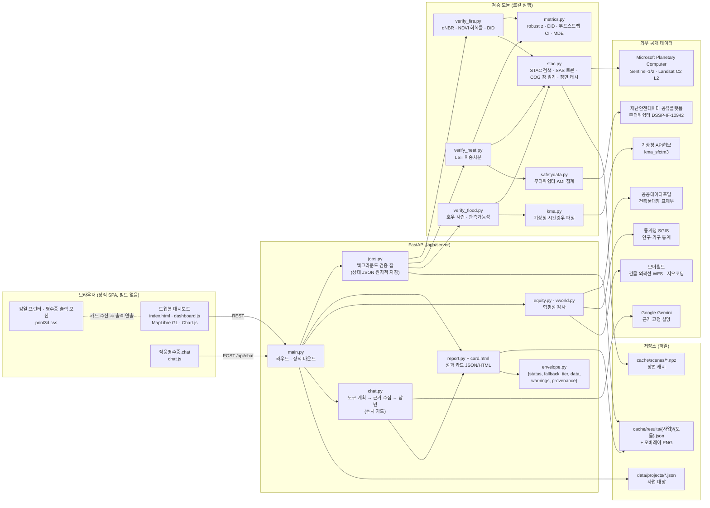
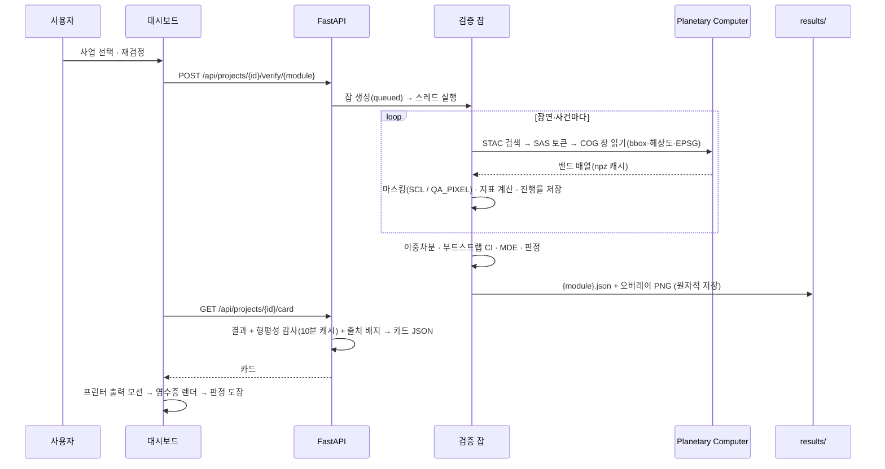

# 적응 영수증 (Adaptation Receipt)

집행이 끝난 기후적응 사업이 실제로 효과를 냈는지, 그 효과가 누구에게 돌아갔는지를 **공개 위성 관측과 준실험 설계로 사후 검증**해, 법정 이행점검 보고서에 그대로 첨부할 수 있는 **성과 카드(영수증)** 로 발급하는 웹서비스입니다.

- 대상 사업: 산불 피해지 복구·복원, 옥상 차열·녹화(열 저감), 하천·배수 정비(침수 방재)
- 산출물: 판정(효과 검출 / 회복 격차 잔존 / 미검출 / 측정 불가)·지표 장부·신뢰구간·검출가능최소효과·형평성 감사·근거 출처가 담긴 카드(JSON·인쇄용 HTML·화면 영수증)
- 원칙: 가상 데이터를 쓰지 않습니다. 관측이 모자라면 0이 아니라 "측정 불가"로 표시하고, 실패한 장면·사건은 이름과 함께 결과에 남깁니다.

---

## 1. 무엇을 해결하는가

지자체·공공기관은 「탄소중립·녹색성장 기본법」에 따라 기후위기 적응대책을 세우고 매년 이행점검 결과를 보고합니다. 그러나 보고서의 성과 항목은 대부분 **집행액·시공 면적 같은 투입 지표**로 채워지고, 사업이 실제로 산림을 회복시켰는지·지표면온도를 낮췄는지·침수 범위를 줄였는지는 확인되지 않은 채 남습니다.

적응 영수증은 이 공백을 다음 세 가지로 메웁니다.

| 모듈 | 질문 | 관측 자료 | 설계 |
|---|---|---|---|
| **산불(fire)** | 피해지의 식생이 인접 미피해 산림 수준으로 회복되고 있는가 | Sentinel-2 L2A(동일 상대궤도, 타일 모자이크) | dNBR 피해등급 → 피해지/대조지 NDVI 회복률 → 이중차분(DiD), 부트스트랩 95% CI, 검출가능최소효과(MDE) |
| **열(heat)** | 시공 블록의 여름 지표면온도가 미시공 인접 블록보다 내려갔는가 | Landsat 8/9 Collection 2 Level-2 지표면온도(`lwir11`, `qa_pixel`) | 처리/대조 폴리곤의 시공 전·후 여름 중앙값 이중차분, MDE, 무더위쉼터 AOI 집계 |
| **침수(flood)** | 정비 전·후 호우 사건을 위성으로 비교할 수 있는가, 침수 범위가 줄었는가 | Sentinel-1 GRD, 기상청 시간강우 | 1단계: 호우 사건 자동 추출(3h≥60mm 또는 1h≥30mm) + 관측가능성 등급 A/B/C → 2단계: 정비 전후 침수 범위 이중차분 실행 조건 판정 |

여기에 **형평성 감사**(건축물대장 표제부·통계청 SGIS·브이월드 건물 외곽선으로 수혜 대상의 노후도·고령 비율을 확인)와 **법정 보고 달력**(이행점검 제출 기한 역산)을 더해, 카드 한 장이 "효과·형평성·제출 시점"을 함께 답하도록 했습니다.

---

## 2. 아키텍처



### 2.1 성과 카드가 만들어지는 흐름



### 2.2 응답 봉투와 출처 배지

모든 API는 같은 봉투로 답합니다.

```json
{ "status": "ok | degraded | error", "fallback_tier": 0,
  "data": { "...": "..." }, "warnings": ["..."], "provenance": { "...": "..." } }
```

카드의 각 지표에는 출처 배지가 붙습니다.

| 배지 | 뜻 |
|---|---|
| `OBSERVED` 실측 | 위성·공공 API에서 그대로 읽은 값 |
| `MODEL` 계산 | 실측값에서 계산한 값(이중차분, 신뢰구간 등) |
| `RULE` 규칙 | 임계값·등급 규칙으로 판정한 값 |
| `ASSUMPTION` 가정 | 가정이 섞인 근사치(독립 화소 가정의 MDE 등) |

표본이 부족하면 값은 `null`이고 화면에는 "측정 불가"로 나옵니다. 0으로 채우지 않습니다.

### 2.3 적응영수증.chat

채팅은 카드에 있는 수치만 인용합니다. 질문의 의도를 분류해 도구(판정·지표 장부·회복 단면도·피해등급·호우 사건·형평성·한계·법정 달력)를 계획하고, 각 도구가 모은 근거 카드를 바탕으로 Gemini가 답을 씁니다. 답변에 근거에 없는 숫자가 섞이면 로컬 요약으로 교체하고, 답과 함께 근거 카드·도구 실행 흔적·화면 이동 버튼·다음 질문 제안을 돌려줍니다. Gemini 키가 없으면 로컬 요약만으로 동작합니다.

---

## 3. 화면

- **도엽(지형도) 세계관**: 화면 전체를 1:25,000 지형도 한 장처럼 구성했습니다. 상단 난외에 도엽번호·사업명, 왼쪽에 도엽 색인(사업 목록)과 다음 법정 기한, 가운데 지면(지도: 지형/영상 베이스, dNBR 피해등급·산불 전후 오버레이, 경위도 눈금·축척), 하단 난외에 관측 장면 눈금과 자료 출처가 놓입니다.
- **영수증**: 오른쪽 난외주기에 감열 프린터가 있고, 카드가 도착하면 영수증이 뽑혀 나오는 3단계 모션(급지 → 절단 → 안착) 뒤 판정 도장이 찍힙니다. 종이 질감·잉크 번짐은 휘도 마스크와 SVG 변위 필터로 구현했습니다.
- **채팅**: 왼쪽 아래 인장 모양 버튼으로 열고 닫는 떠 있는 패널입니다.

---

## 4. 저장소 구조

```
.
├─ api/index.py                 Vercel 서버리스 진입점(FastAPI 앱 노출)
├─ vercel.json · requirements.txt(배포용 최소 의존성)
├─ app/
│  ├─ server/                   FastAPI · 검증 모듈 · 형평성 · 채팅 · 카드
│  ├─ web/                      정적 프런트(index.html, *.css, *.js, assets/)
│  ├─ data/projects/            사업 대장 JSON(산불·열·침수 시드 3건)
│  ├─ data/shelters_heat_slim.json   무더위쉼터 전수(필드 축약, 배포본 동봉)
│  ├─ cache/results/            검증 결과·오버레이(커밋 대상) / scenes·jobs는 로컬 캐시
│  ├─ tests/                    pytest(지표 계산 · API · 채팅)
│  ├─ requirements-full.txt     로컬 전체 실행용(rasterio 등 포함)
│  └─ README.md                 서버 구조 · API 표 · 외부 API 실측 메모 · 배포 절차
├─ scripts/                     기획안 그림 생성(위성 회복률, 모식도)
├─ figures/                     생성된 그림
├─ docs/ · reports/ · research_notes/   설계 명세 · 조사 노트
├─ DESIGN.md · PRODUCT.md       화면 디자인 규격 · 제품 정의
└─ 2026_기후변화대응_비즈니스아이디어_기획안_적응영수증.docx / .pdf   기획안
```

---

## 5. 실행

### 로컬(위성 검증 포함)

```bash
pip install -r app/requirements-full.txt
```

```bash
copy app\.env.example app\.env
```

`.env`에 키를 채운 뒤(비워 두면 해당 모듈은 "키 필요"로 표시되고 나머지는 동작합니다):

```bash
python -m uvicorn app.server.main:app --port 8008
```

브라우저에서 `http://localhost:8008/`. 테스트:

```bash
python -m pytest app/tests -q
```

### 배포본(Vercel)

`api/index.py`와 `vercel.json`으로 바로 가져올 수 있습니다. 배포본은 **읽기 전용**으로 동작해 카드·영수증·채팅·형평성 감사·법정 달력을 제공하고, 위성 재검정 요청은 503과 안내문을 돌려줍니다. 재검정은 로컬에서 실행한 뒤 `app/cache/results/`를 커밋하면 반영됩니다. 필요한 환경변수 이름과 순서는 `app/README.md`의 배포 절을 참고하십시오.

| 환경변수 | 용도 |
|---|---|
| `GEMINI_API_KEY`, `GEMINI_MODEL` | 채팅 설명(없으면 로컬 요약) |
| `DATA_GO_KR_SERVICE_KEY` | 건축물대장 표제부 |
| `SGIS_CONSUMER_KEY`, `SGIS_CONSUMER_SECRET` | 통계청 SGIS |
| `VWORLD_API_KEY` | 브이월드 건물 외곽선·지오코딩 |
| `KMA_APIHUB_KEY` | 기상청 시간강우 |
| `SAFETYDATA_KEY_SHELTER` | 무더위쉼터 갱신(등록 IP 전용, 배포본은 동봉 파일 사용) |

---

## 6. API 요약

| 메서드 | 경로 | 설명 |
|---|---|---|
| GET | `/api/health` | 키 설정 여부(값 미노출) |
| GET / POST | `/api/projects`, `/api/projects/{id}` | 사업 목록·상세·등록 |
| POST | `/api/projects/{id}/verify/{fire\|heat\|flood}` | 검증 잡 시작(배포본은 503) |
| GET | `/api/jobs/{job_id}`, `/api/jobs?project_id=` | 잡 상태·진행률 |
| GET | `/api/projects/{id}/card`, `/card/{id}` | 성과 카드 JSON · 인쇄용 HTML |
| GET | `/api/equity/{id}` | 형평성 감사 |
| POST | `/api/chat` | 적응영수증.chat |
| GET | `/api/projects/{id}/overlay/{dnbr\|pre\|post}.png` | 지도 오버레이 |
| GET | `/api/calendar` | 법정 보고 달력 |

사업 JSON 스키마와 외부 API 실측 메모(응답 형식·재시도 조건)는 `app/README.md`에 있습니다.

---

## 7. 한계

- 미검출은 효과가 없다는 증명이 아닙니다. 30 m 열적외(원 100 m)에서는 단일 동 규모의 효과가 검출되기 어렵고, Landsat은 오전 통과라 야간 열섬을 보지 못합니다.
- 검출가능최소효과(MDE)는 독립 화소 가정의 낙관적 근사치입니다.
- 침수 모듈의 2단계(침수 범위 이중차분)는 실행 조건 판정까지 구현되어 있습니다.
- 지표면온도는 기온·실내온도가 아니며, 위성 관측은 현장조사를 대체하지 않고 우선순위를 정하는 데 쓰입니다.

## 8. 자료 출처

Copernicus Sentinel-1/2 (ESA), Landsat 8/9 (USGS), Microsoft Planetary Computer, 기상청 API허브, 행정안전부 재난안전데이터 공유플랫폼, 공공데이터포털(국토교통부 건축물대장), 통계청 SGIS, 브이월드, OpenFreeMap · OpenMapTiles · OpenStreetMap.
