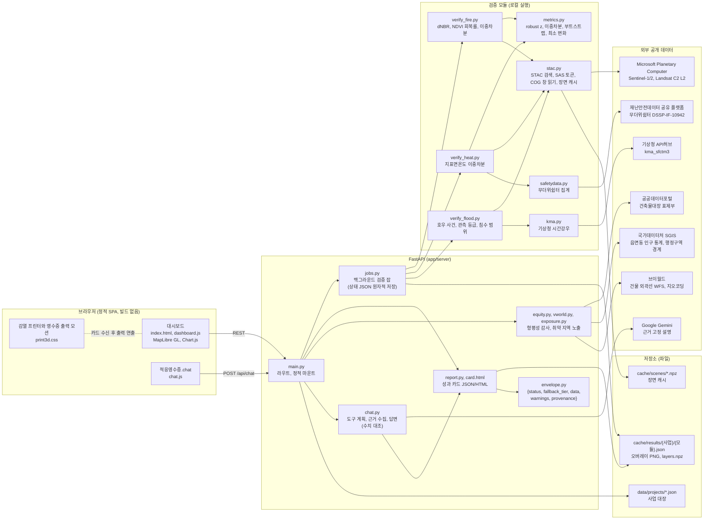
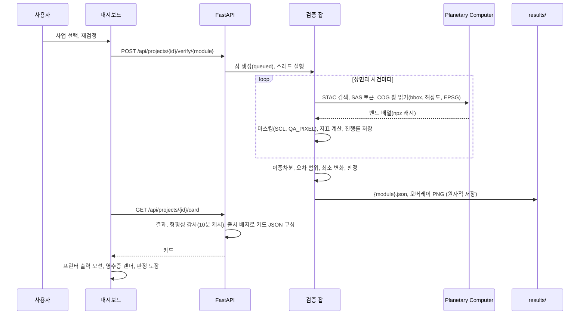

# 적응 영수증 (Adaptation Receipt)

적응 영수증은 집행이 끝난 기후적응 사업이 실제로 효과를 냈는지, 그 효과가 취약한 주민에게 닿았는지를 **공개 위성 관측과 준실험 설계로 사후 검증**하는 웹서비스입니다. 검증 결과는 법정 이행점검 보고서에 첨부할 수 있는 **성과 카드**로 발급합니다.

- 대상 사업: 산불 피해지 복구와 복원, 옥상 차열과 녹화, 하천과 배수 정비
- 산출물: 판정, 핵심 수치, 오차 범위, 알아볼 수 있는 최소 변화, 취약 지역 노출, 형평성 감사, 자료 출처를 담은 성과 카드. 형식은 JSON, 인쇄용 HTML, 화면 영수증의 세 가지
- 원칙: 가상 데이터를 쓰지 않습니다. 관측이 부족하면 0으로 채우지 않고 "측정 불가"로 표시하며, 실패한 장면과 사건은 이름과 함께 결과에 남깁니다.

배포본: https://adaptation-receipt-two.vercel.app

---

## 1. 해결하려는 문제

지방자치단체와 공공기관은 「탄소중립기본법」에 따라 기후위기 적응대책을 수립하고 매년 이행점검 결과를 보고합니다. 그러나 보고서의 성과 항목은 대부분 집행액과 시공 면적 같은 투입 지표로 작성되며, 사업이 산림을 회복시켰는지, 지표면온도를 낮췄는지, 침수 범위를 줄였는지는 확인되지 않습니다.

적응 영수증은 세 가지 검증 모듈로 이 단계를 담당합니다.

| 모듈 | 검증 질문 | 관측 자료 | 설계 |
|---|---|---|---|
| **산불(fire)** | 피해지 식생이 주변 숲 수준으로 회복되고 있는가 | Sentinel-2 L2A(동일 상대궤도, 타일 모자이크), 산림청 5차 임상도 | 임상도 입목지 안의 dNBR 피해등급, 피해지와 비교 구역의 NDVI 회복률, 이중차분, 부트스트랩 95% 오차 범위, 알아볼 수 있는 최소 변화 |
| **열(heat)** | 시공 동의 여름 지표면온도가 비교 동보다 내려갔는가 | Landsat 8/9 Collection 2 Level-2 지표면온도(`lwir11`, `qa_pixel`) | 시공 동과 비교 동의 시공 전후 여름 중앙값 이중차분, 알아볼 수 있는 최소 변화와 필요 시공 면적, 무더위쉼터 집계 |
| **침수(flood)** | 같은 세기의 비에서 침수 범위가 줄었는가 | Sentinel-1 RTC, 기상청 시간강우 | 호우 사건 자동 추출(3시간 60 mm 또는 1시간 30 mm 이상), 관측 등급 A/B/C, 정비 전후 침수 범위와 강우량당 침수 면적 비교 |

여기에 두 가지 분석을 더해, 카드 한 장이 효과, 형평성, 제출 시점을 함께 보여 주도록 했습니다.

- **형평성 감사와 취약 지역 노출:** 건축물대장 표제부, 국가데이터처 SGIS, 브이월드 건물 외곽선으로 수혜 대상의 노후도와 고령 비율을 확인합니다.
- **법정 보고 달력:** 이행점검 제출 기한에서 거꾸로 계산한 일정을 보여 줍니다.

### 판정

| 모듈 | 판정 |
|---|---|
| 산불 | 회복 미달, 회복 수준 도달, 측정 불가 |
| 열 | 효과 확인, 효과 미확인, 측정 불가 |
| 침수 | 침수 저감 확인, 침수 저감 미확인, 관측 대기 |

판정에 쓰는 임계값과 비교 구역은 결과를 산출하기 전에 사업 대장 JSON에 기록합니다. 재검정 시 이전 판정과 변경 사유를 카드에 남기는 기능은 파일럿 단계에서 추가할 예정입니다.

---

## 2. 아키텍처



### 2.1 성과 카드 생성 흐름



### 2.2 응답 봉투와 출처 배지

모든 API는 같은 봉투 형식으로 응답합니다.

```json
{ "status": "ok | degraded | error", "fallback_tier": 0,
  "data": { "...": "..." }, "warnings": ["..."], "provenance": { "...": "..." } }
```

카드의 각 수치에는 출처 배지가 붙습니다.

| 배지 | 의미 |
|---|---|
| `OBSERVED` 실측 | 위성과 공공 API에서 그대로 읽은 값 |
| `MODEL` 계산 | 실측값에서 계산한 값(이중차분, 오차 범위 등) |
| `RULE` 규칙 | 임계값과 등급 규칙으로 판정한 값 |
| `ASSUMPTION` 가정 | 가정이 포함된 근사치(화소 독립 가정의 최소 변화 등) |

표본이 부족하면 값은 `null`이며 화면에는 "측정 불가"로 표시됩니다.

### 2.3 적응영수증.chat

설명 대화는 카드에 기재된 수치만 인용합니다. 질문의 의도를 분류해 판정, 수치 장부, 회복 단면, 피해등급, 호우 사건, 형평성, 한계, 법정 달력 가운데 필요한 도구를 고르고, 도구가 모은 근거 카드를 바탕으로 Gemini가 답변을 작성합니다. 답변에 근거에 없는 숫자가 포함되면 로컬 요약으로 교체합니다. Gemini 키가 없으면 로컬 요약만으로 동작합니다.

---

## 3. 화면

화면은 적응대책 담당자와 관리자의 두 사용자를 기준으로 구성합니다.

- **담당자(주무관):** 「내 사업」에서 사업을 고르거나 새로 등록하여 성과 카드를 받고, 「보고서 부록」을 인쇄합니다.
- **관리자(과장, 의회):** 「관할 요약」에서 사업별 결론과 조치 사항을 한 표로 확인합니다.

화면에는 쉬운 말을 쓰고, 이중차분, dNBR 같은 전문 용어와 전체 수치는 카드 아래 「자세한 수치와 근거」와 JSON에 둡니다. 화면과 인쇄 카드의 문장은 명사형 종결로, 표의 칸과 라벨은 명사형으로 통일합니다.

| 구성 | 내용 |
|---|---|
| 성과 카드 | 판정 도장, 결론 한 줄, 근거 항목, 핵심 수치 3개, 조치 사항, 식생 회복 추이(산불), 형평성. 요약 문장은 서버가 모듈 결과에서만 생성(`report.plain_summary`) |
| 새 사업 등록 | 사업 대장 한 줄(사업명, 종류, 기관, 기간, 예산)을 입력하고 지도에서 범위를 그리면 등록과 위성 검정 시작. 옥상 차열은 지도에서 시공 동과 비교 동 선택. 읽기 전용 배포본에서는 저장하지 않음 |
| 관할 요약 | 검정한 사업 수, 효과 확인과 미확인 건수, 예산 합계, 다음 보고 기한, 사업별 결론 |
| 검증 설계 수준 | 카드마다 사업 효과 검증(사업 구역 대 비교 구역)인지 현장 변화 분석(사업 경계 미확보)인지 표시하고, 경계 결합 시의 전환 방법 기재 |
| 취약 지역 노출 | 산불 피해와 침수 화소를 국가데이터처 SGIS 읍면동 경계에 겹쳐 고령화지수와 노년부양비를 분석 범위 전체와 비교(`app/server/exposure.py`, 결과 `exposure.json`) |

취약 지역 노출 결과는 다음과 같습니다.

| 사업 | 고령화지수 중앙값 이상 읍면의 피해 비율 | 피해 면적 가중 고령화지수 | 분석 범위 평균 |
|---|---|---|---|
| 의성, 안동 산불 | 83% | 1,805 | 756 |
| 부여 배수 정비 | 32% | 901 | 848 |

### 지도

AWS 공개 지형 타일로 만든 3D 지형과 음영기복 위에 위성영상과 건물을 세우고, 사업 종류별 오버레이를 표시합니다. 도구막대의 3D 버튼으로 평면 지도와 전환합니다.

- **오버레이:** 산불은 dNBR 피해등급과 산불 전후 진색 합성, 열은 시공 전후 지표면온도와 그 차이, 침수는 정비 전후 침수 범위와 호우 사건별 범위입니다.
- **범례:** 서버가 범례를 구조화해 내려 주고(`overlays.legend`) 화면이 색 견본과 눈금을 그립니다.
- **지점 값 조회:** 지도를 누르면 그 화소의 등급이나 온도를 표시합니다. 검증 모듈이 저장한 `layers.npz`를 `/api/projects/{id}/query`가 읽습니다.
- **전후 비교:** 화면을 두 지도로 나누고 손잡이를 끌어 산불 전후, 시공 전후, 정비 전후를 비교합니다.
- **시간 순 재생:** 산불은 장면별 식생지수, 침수는 호우 사건별 범위를 타임라인으로 넘겨 봅니다.
- **침수 표시:** 침수 화소는 범위 전체에 흩어져 작게 보이므로, 화면용 PNG에서만 2화소 넓히고 흰 테두리를 둘러 표시합니다. 통계에는 원래 화소를 씁니다.
- **인쇄 카드 장면:** 카드 인쇄 시 현재 지도 장면을 인쇄 카드 머리에 넣습니다. 장면은 `POST /api/projects/{id}/snapshot`으로 저장하며, 읽기 전용 배포본에서는 브라우저 저장소를 씁니다.

### 화면 디자인

헤더, 사업 목록, 지도 도구, 하단 탭, 대화창은 반투명 유리 패널로 통일하고(`glass.css`), 성과 카드만 감열 영수증 종이와 판정 도장으로 표현합니다. 카드가 도착하면 오른쪽 프린터에서 영수증이 출력되는 3단계 모션(급지, 절단, 안착) 뒤에 판정 도장이 찍힙니다.

---

## 4. 저장소 구조

```
.
├─ api/index.py                 Vercel 서버리스 진입점(FastAPI 앱 노출)
├─ vercel.json, requirements.txt(배포용 최소 의존성)
├─ app/
│  ├─ server/                   FastAPI, 검증 모듈, 형평성, 취약 지역 노출, 채팅, 카드
│  ├─ web/                      정적 프런트(index.html, *.css, *.js, assets/)
│  ├─ data/projects/            사업 대장 JSON(산불, 열, 침수 3건)
│  ├─ data/shelters_heat_slim.json   무더위쉼터 전수(필드 축약, 배포본 동봉)
│  ├─ cache/results/            검증 결과와 오버레이(커밋 대상). scenes, jobs는 로컬 캐시
│  ├─ tests/                    pytest(지표 계산, API, 채팅)
│  ├─ requirements-full.txt     로컬 전체 실행용(rasterio 등 포함)
│  └─ README.md                 서버 구조, API 표, 외부 API 실측 기록, 배포 절차
└─ figures/                     그림, logos/(구성도 로고와 출처)
```

---

## 5. 실행

### 로컬(위성 검증 포함)

```bash
pip install -r app/requirements-full.txt
```

```bash
copy app\.env.example app\.env
```

`.env`에 키를 입력합니다. 비워 두면 해당 모듈은 "키 필요"로 표시되고 나머지 기능은 동작합니다.

```bash
python -m uvicorn app.server.main:app --port 8008
```

브라우저에서 `http://localhost:8008/`을 엽니다. 테스트는 다음과 같이 실행합니다.

```bash
python -m pytest app/tests -q
```

### 배포본(Vercel)

`api/index.py`와 `vercel.json`으로 배포합니다. 배포본은 **읽기 전용**으로 동작하여 카드, 영수증, 채팅, 형평성 감사, 법정 달력을 제공하고, 위성 재검정 요청에는 503과 안내문을 반환합니다. 재검정은 로컬에서 실행한 뒤 `app/cache/results/`를 커밋하면 반영됩니다. 환경변수 설정 순서는 `app/README.md`의 배포 절을 참고하십시오.

| 환경변수 | 용도 |
|---|---|
| `GEMINI_API_KEY`, `GEMINI_MODEL` | 설명 대화(없으면 로컬 요약) |
| `DATA_GO_KR_SERVICE_KEY` | 건축물대장 표제부 |
| `SGIS_CONSUMER_KEY`, `SGIS_CONSUMER_SECRET` | 국가데이터처 SGIS |
| `VWORLD_API_KEY` | 브이월드 건물 외곽선, 지오코딩 |
| `KMA_APIHUB_KEY` | 기상청 시간강우 |
| `SAFETYDATA_KEY_SHELTER` | 무더위쉼터 갱신(등록 IP 전용, 배포본은 동봉 파일 사용) |

---

## 6. API 요약

| 메서드 | 경로 | 설명 |
|---|---|---|
| GET | `/api/health` | 키 설정 여부(값 미노출) |
| GET / POST | `/api/projects`, `/api/projects/{id}` | 사업 목록, 상세, 등록 |
| POST | `/api/projects/{id}/verify/{fire\|heat\|flood}` | 검증 잡 시작(배포본은 503) |
| GET | `/api/jobs/{job_id}`, `/api/jobs?project_id=` | 잡 상태와 진행률 |
| GET | `/api/projects/{id}/card`, `/card/{id}` | 성과 카드 JSON, 인쇄용 HTML |
| GET | `/api/equity/{id}` | 형평성 감사 |
| POST | `/api/chat` | 적응영수증.chat |
| GET | `/api/projects/{id}/overlay/{name}.png` | 지도 오버레이(dnbr, pre, post, lst_*, flood_*, flood_evt_YYYYMMDD) |
| GET | `/api/projects/{id}/query?layer=&lon=&lat=` | 지도 지점의 오버레이 값(등급 또는 ℃) |
| POST / GET | `/api/projects/{id}/snapshot`, `/api/projects/{id}/snapshot.jpg` | 인쇄 카드용 지도 장면 저장과 제공(배포본은 저장 503) |
| GET | `/api/calendar` | 법정 보고 달력 |

사업 JSON 스키마와 외부 API의 응답 형식, 재시도 조건 실측 기록은 `app/README.md`에 있습니다.

---

## 7. 한계

- 효과 미확인은 효과가 없다는 증명이 아닙니다. 30 m 열적외 자료(원 해상도 100 m)로는 단일 동 규모의 효과를 판별하기 어렵고, Landsat은 오전에 통과하므로 야간 열섬을 관측하지 못합니다.
- 알아볼 수 있는 최소 변화는 화소 독립 가정의 근사치로, 실제 판별 가능한 변화보다 작게 계산됩니다.
- 침수 범위는 위성 첫 통과 시점의 수면만 포착합니다.
- 산불 피해 산정의 산림 범위는 산림청 5차 임상도(1:25,000) 입목지 기준이며, 임상도 제작 이후의 토지 이용 변화는 반영하지 않습니다.
- 의성과 부여는 사업 경계 자료가 없어 현장 변화 분석 단계이며, 경계를 확보하면 사업 효과 검증으로 다시 판정합니다.
- 지표면온도는 기온이나 실내온도가 아닙니다. 위성 관측은 현장조사를 대체하지 않으며, 현장 확인 대상의 우선순위를 정하는 데 사용합니다.

## 8. 자료 출처

Copernicus Sentinel-1/2(ESA), Landsat 8/9(USGS), Microsoft Planetary Computer, 기상청 API허브, 행정안전부 재난안전데이터 공유 플랫폼, 공공데이터포털(국토교통부 건축물대장), 국가데이터처 SGIS, 브이월드, OpenFreeMap, OpenMapTiles, OpenStreetMap.
